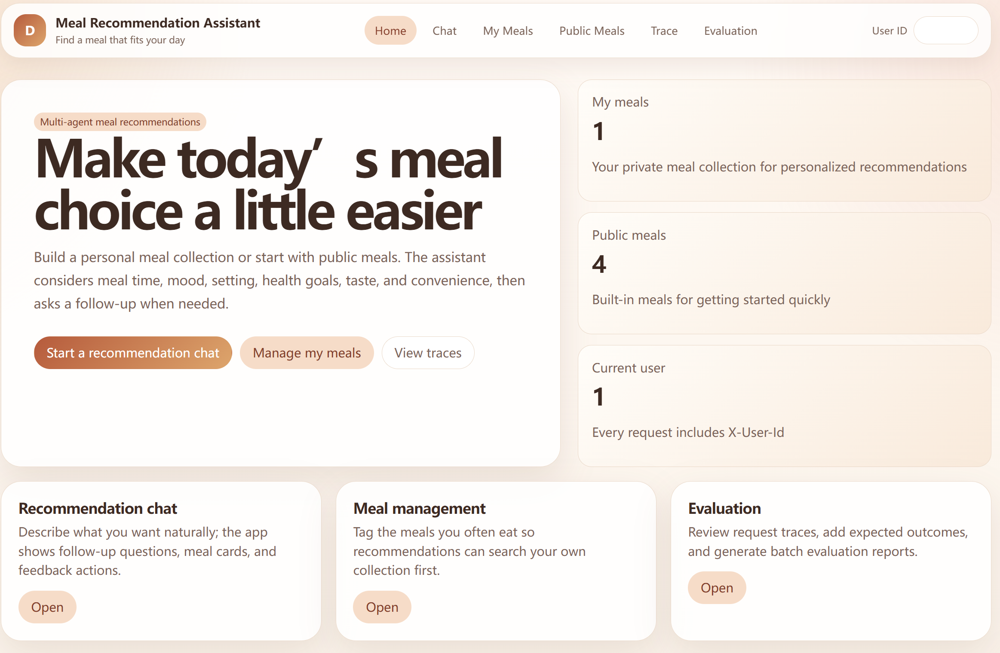
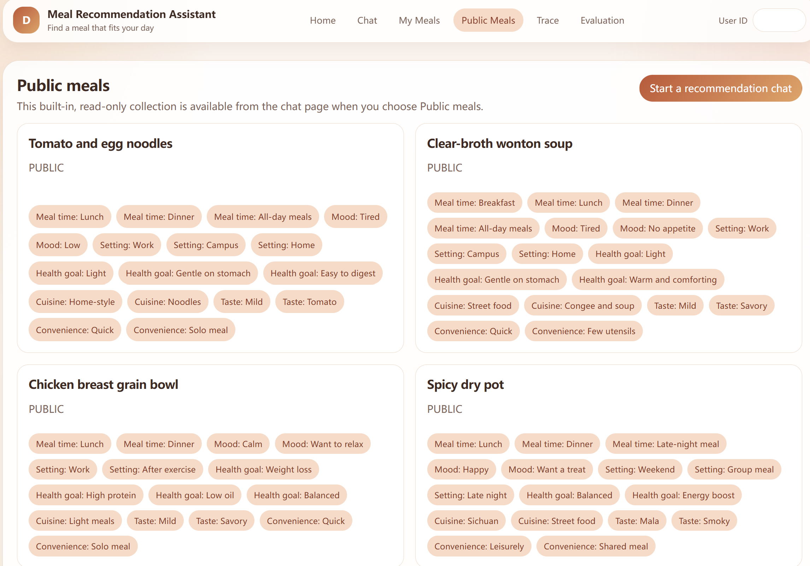
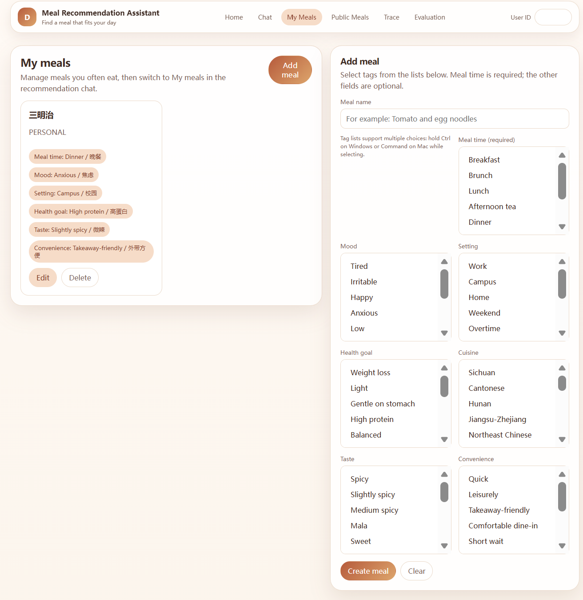
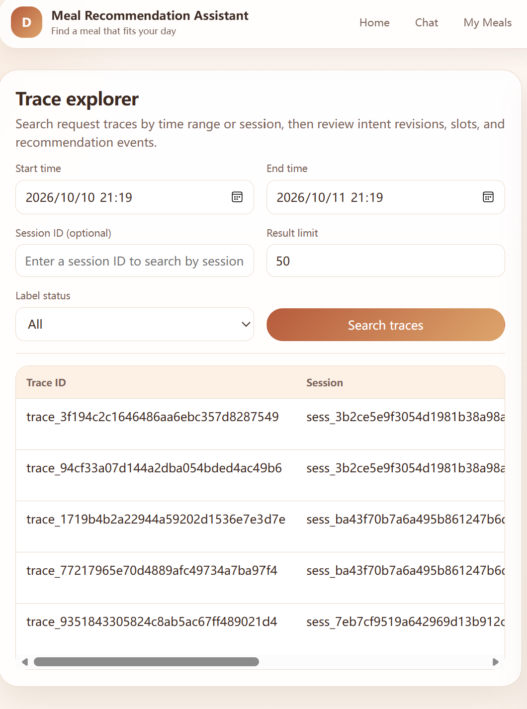
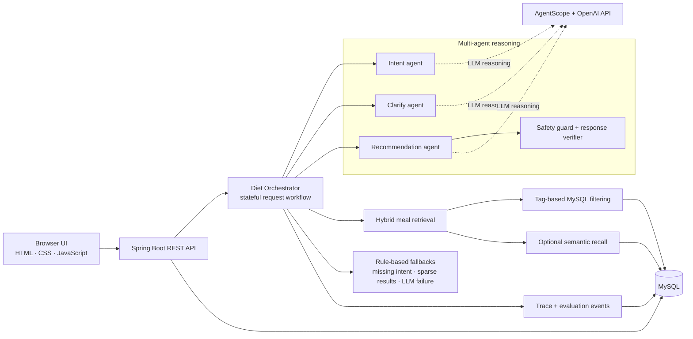
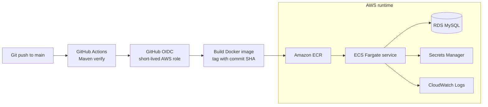

# Meal Recommendation Assistant

[](https://github.com/YilinMargaretYan/meal-planner-agent-/actions/workflows/ci.yml)

A full-stack meal recommendation application that combines multi-agent reasoning, hybrid retrieval, rule-based fallbacks, and a traceable Spring Boot backend. Users can maintain a personal meal collection or use built-in public meals, then receive recommendations based on meal time, mood, setting, health goals, cuisine, taste, and convenience.

## Highlights

- **Multi-agent recommendation workflow:** Uses AgentScope and the OpenAI API for intent recognition, clarification, recommendation generation, safety checks, and response verification.
- **Hybrid retrieval with resilience:** Combines tag-based MySQL retrieval with optional semantic search; deterministic fallback rules handle uncertain intent, incomplete requests, unavailable matches, and LLM failures.
- **Traceability and evaluation:** Persists request traces, agent events, session state, user feedback, and evaluation labels for inspection and quality review.
- **Bilingual-friendly UI:** Shows English-first labels alongside the original Chinese tag values, preserving compatibility with existing records. Built-in public meals display English names.
- **Secure cloud delivery:** Containerized with Docker and deployable to AWS ECS Fargate through GitHub Actions CI/CD using GitHub OIDC.

## Interface preview

| Home | Public meal collection |
| --- | --- |
|  |  |

| Personal meal management | Trace explorer |
| --- | --- |
|  |  |

> Screenshots use demonstration data. Do not include API keys, database endpoints, or full request-trace payloads in public documentation.

## Architecture

### Runtime workflow



### Delivery workflow



## Technology

- Java 21, Spring Boot 3, MyBatis, MySQL 8
- AgentScope and OpenAI API
- HTML, CSS, and vanilla JavaScript
- Maven and JUnit
- Docker
- AWS ECS Fargate, ECR, RDS, Secrets Manager, and CloudWatch
- Git/GitHub version control and GitHub Actions CI/CD

## Run locally

### Prerequisites

- Java 21
- Maven
- MySQL 8 running locally
- An OpenAI API key for AI-powered chat features

### 1. Create or load the local database

Create a local database named `diet_db`. Then run [`src/main/resources/db/diet_db.sql`](src/main/resources/db/diet_db.sql) against that database using MySQL Workbench or another MySQL client.

> The seed file recreates this application's tables. Use it only for a local development database, or back up local data first.

### 2. Set environment variables

In PowerShell, from the project directory:

```powershell
cd D:\Code\diet-agent

$env:DB_URL = "jdbc:mysql://localhost:3306/diet_db"
$env:DB_USERNAME = "root"
$env:DB_PASSWORD = "your-local-mysql-password"
$env:OPENAI_API_KEY = "your-openai-api-key"
```

Never commit real credentials. The variables above apply only to the open PowerShell session.

### 3. Start the application

```powershell
mvn spring-boot:run
```

Open [http://localhost:8080/#/diet](http://localhost:8080/#/diet).

## Test

```powershell
mvn verify
```

The GitHub Actions CI workflow runs this command for pushes and pull requests to `main`.

## Containerize

```powershell
docker build -t diet-agent:local .
docker run --rm -p 8080:8080 `
  -e DB_URL="jdbc:mysql://host.docker.internal:3306/diet_db" `
  -e DB_USERNAME="root" `
  -e DB_PASSWORD="your-local-mysql-password" `
  -e OPENAI_API_KEY="your-openai-api-key" `
  diet-agent:local
```

## AWS deployment

The deployment workflow runs after a push to `main`:

1. GitHub Actions receives a short-lived AWS credential through OIDC.
2. The workflow builds a Docker image tagged with the commit SHA.
3. The image is pushed to Amazon ECR.
4. A new ECS task-definition revision points to that image.
5. ECS updates the service.

Required GitHub repository secret:

```text
AWS_DEPLOY_ROLE_ARN
```

Runtime secrets, such as the database password and OpenAI API key, belong in AWS Secrets Manager—not source control or GitHub workflow files.

### Cost control

For a paused demo environment, set the ECS service desired task count to `0` and stop the RDS instance temporarily. RDS can remain stopped for up to seven days before AWS automatically starts it again; storage and backup charges still apply.

## Repository layout

```text
src/main/java/                 Spring Boot application, agents, services, controllers
src/main/resources/mapper/     MyBatis SQL mappings
src/main/resources/db/         Local database seed and migration scripts
src/main/resources/static/     Browser UI assets
src/test/java/                 Unit tests
.github/workflows/             CI and ECS deployment workflows
Dockerfile                     Container definition
```

## Security notes

- Keep `.env` files, database passwords, API keys, and AWS credentials out of Git.
- Use GitHub OIDC for AWS deployments instead of long-lived access keys.
- Use least-privilege IAM permissions and security groups that allow only required connections.
